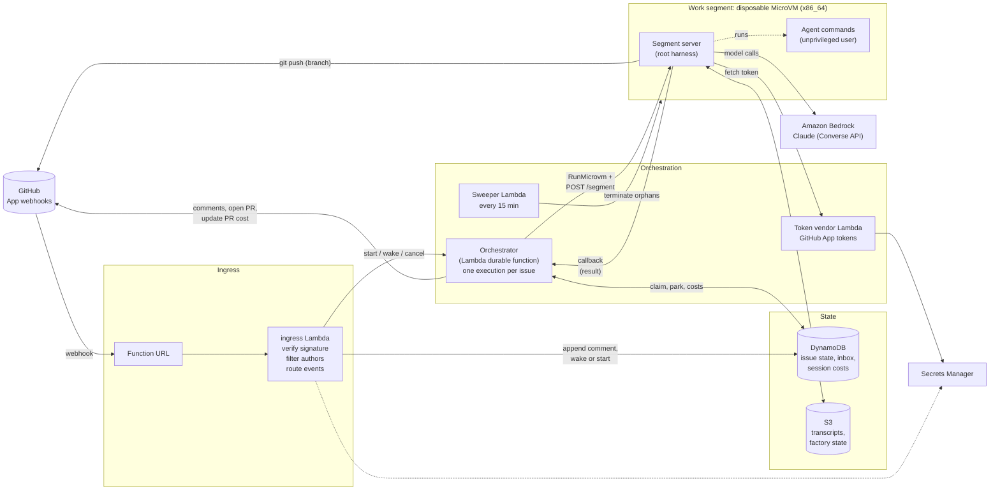
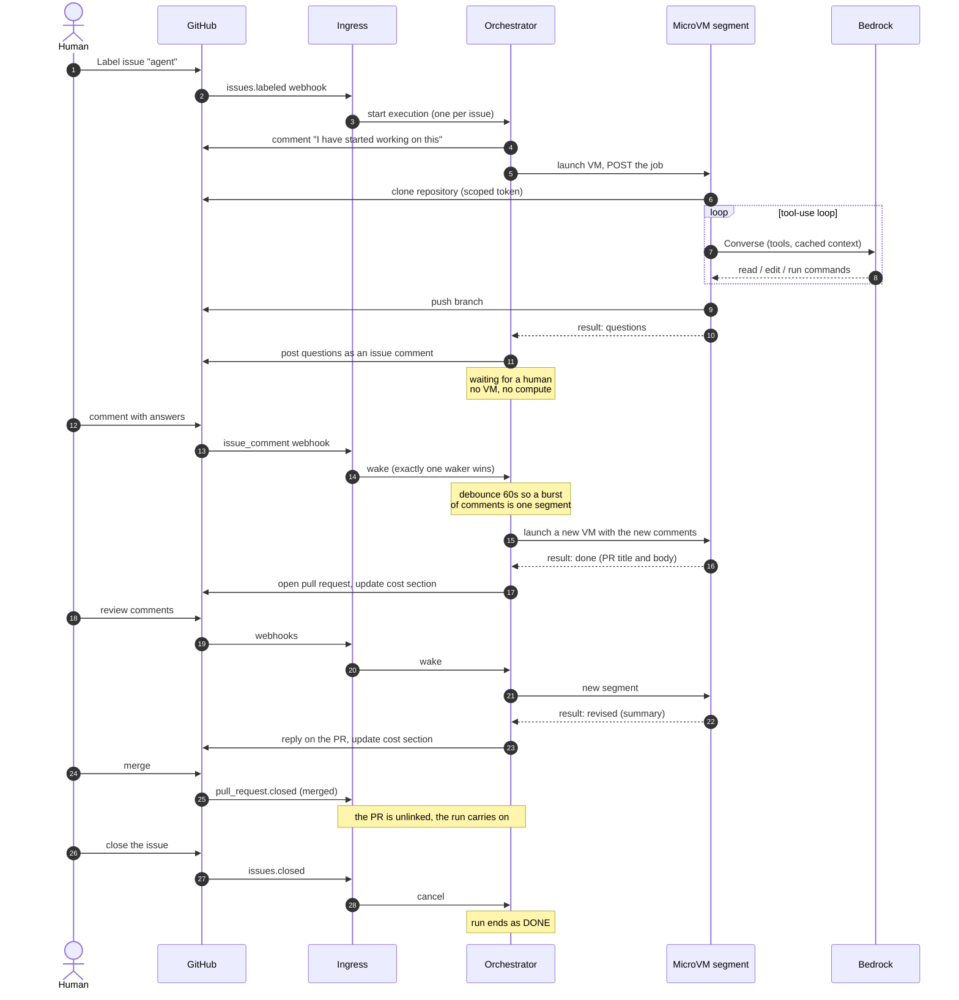
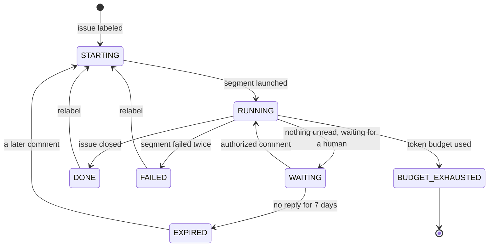
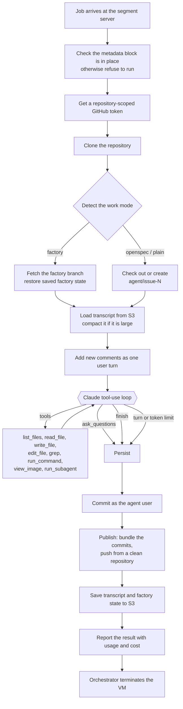
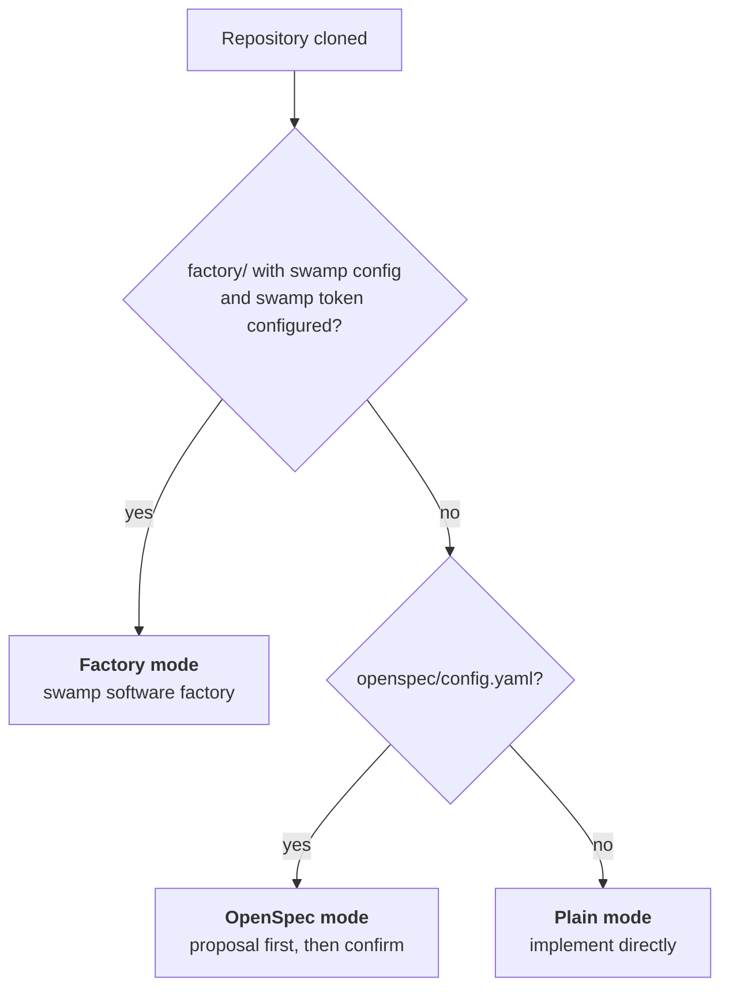
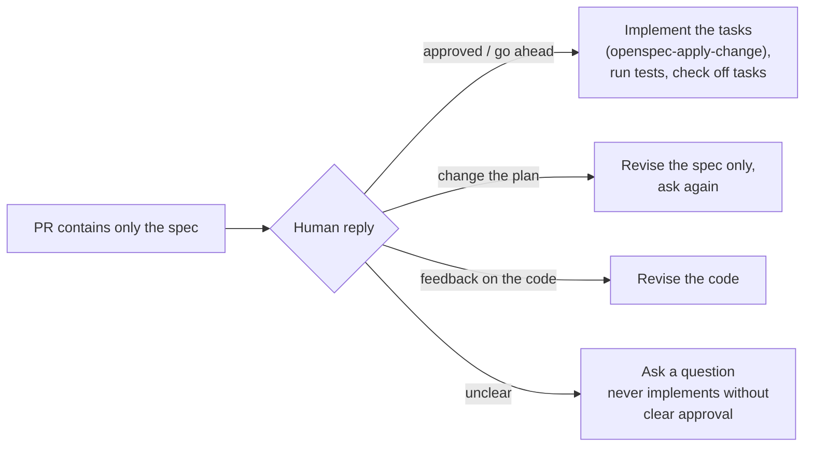
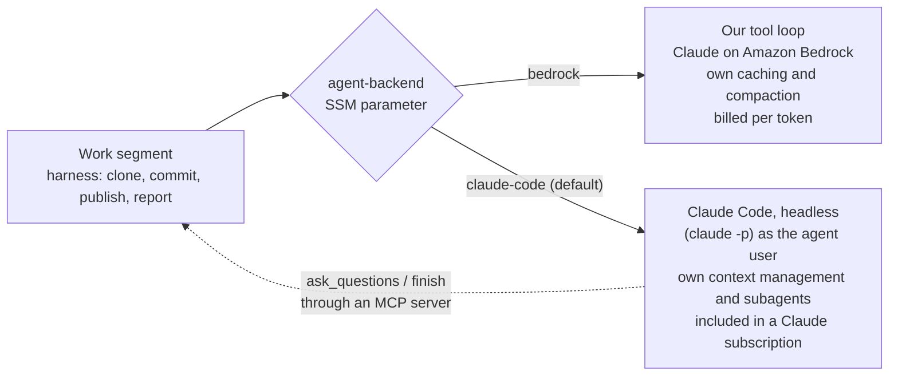
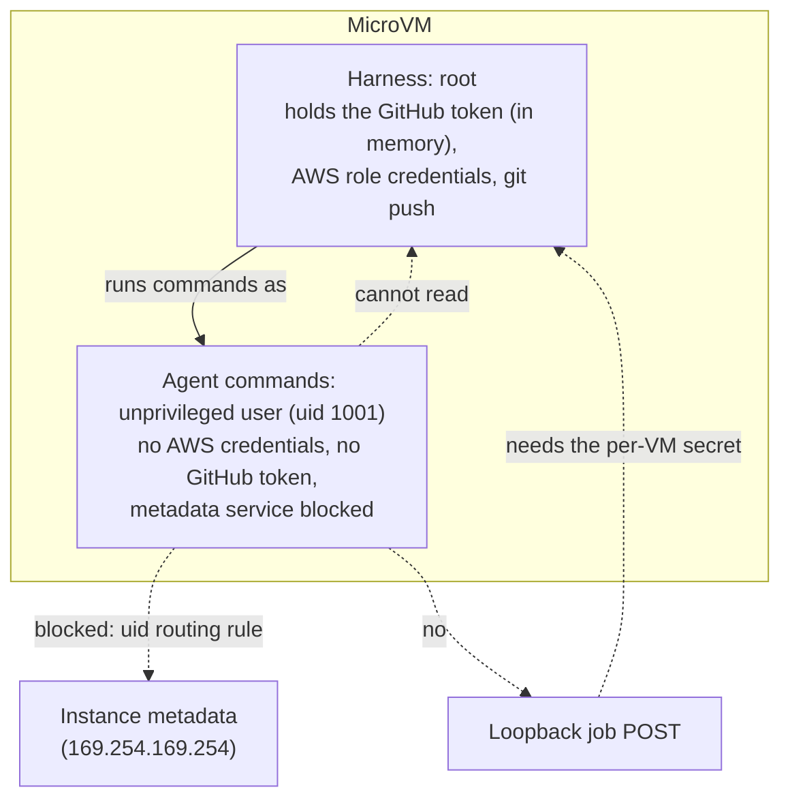

# AI Developer Agent

An autonomous coding agent that works GitHub issues from start to finish. You label an issue. The agent reads the repository, asks questions in the issue comments when it is blocked, writes the change, opens a pull request, and revises it as reviewers comment. It keeps going until the issue is closed. If the issue needs more than one pull request, a later comment starts the next one.

It runs on AWS and is built around one constraint: **the agent waits for humans for free.** People answer in minutes or in days. While the agent waits, nothing is running and nothing is billed for compute.

- [How it works](#how-it-works)
- [Architecture](#architecture)
- [The life of an issue](#the-life-of-an-issue)
- [How the agent does the work](#how-the-agent-does-the-work)
- [Choosing the model backend](#choosing-the-model-backend)
- [Overriding the model per issue](#overriding-the-model-per-issue)
- [Security model](#security-model)
- [Cost and limits](#cost-and-limits)
- [Repository layout](#repository-layout)
- [Setup and deployment](#setup-and-deployment)
- [Configuration](#configuration)
- [Operating it](#operating-it)
- [Development](#development)
- [Known limitations](#known-limitations)

## How it works

1. A GitHub App is installed on your repositories. It sends webhooks for issues, comments, pull requests and reviews.
2. Applying the `agent` label to an issue starts a run. Only the label starts one, and applying a label already needs triage permission.
3. A **durable orchestrator** (a Lambda durable function) owns the run. It launches short-lived **work segments**, one at a time, and waits for people in between.
4. Each segment runs in a disposable **Lambda MicroVM**. It clones the repository, runs Claude (through Amazon Bedrock, or through Claude Code on a Claude subscription: you [choose](#choosing-the-model-backend)), commits and pushes, and reports back. Then the VM is terminated.
5. Comments from authorized people (owners, members and collaborators) wake the orchestrator, which starts another segment with the new comments.
6. The run ends when the issue is closed (done). Merging or closing a pull request does not end it: the pull request is unlinked, and the next comment on the issue starts a new pull request on a fresh branch (`agent/issue-<n>`, then `agent/issue-<n>-2`, and so on).

Nothing about the agent lives in a long-running process. Everything it knows is rebuilt for each segment from three places: the Git branch, a transcript in S3, and a DynamoDB record. A lost segment loses only the work of that one segment.

## Architecture



| Piece | What it does |
|---|---|
| **GitHub App** | Delivers webhooks for `issues`, `issue_comment`, `pull_request`, `pull_request_review` and `pull_request_review_comment`. Installed once, works for every repository it is installed on. |
| **Ingress** | A public Function URL. Verifies the webhook signature, drops duplicates and bots, applies the author rules, and starts, wakes or cancels runs. |
| **Orchestrator** | A Lambda durable function, one execution per issue. Sequences segments, waits for humans, retries, enforces budgets, posts comments, opens pull requests. |
| **Work segment** | A Lambda MicroVM running the segment server. Does the actual coding work, then is terminated. |
| **Token vendor** | The only component that can read the GitHub App private key. Mints installation tokens scoped to one repository. |
| **Sweeper** | Terminates MicroVMs that outlived their segment or that no run refers to. |
| **DynamoDB** | One table: per-issue record, comment inbox, pull request links, webhook de-duplication, per-session costs. |
| **S3** | Agent transcripts (versioned, encrypted with a customer-managed KMS key) and saved factory state. |

## The life of an issue



### Run states



The states that matter:

- **WAITING** costs nothing. The orchestrator is suspended and no VM exists.
- **EXPIRED** is the same idea with a time limit: after seven days without a reply the run stops and posts a note. Any later comment resumes it from saved state.
- **BUDGET_EXHAUSTED** is the end of the line for a run that has used its budget. The agent posts a summary of where it got to, and opens a **draft** pull request if it pushed any commits.
- **DONE** means the issue was closed. It does not accept comments, but relabeling the issue (after reopening it) restarts the run. Older records may say **CLOSED**, which is treated the same way.
- **BUDGET_EXHAUSTED** does not accept comments, and restarts on relabel only while token budget remains.
- A merged or closed **pull request** does not change the state. It only unlinks the pull request, so the run can open the next one.
- When a comment or relabel reaches an ended run, the agent says so in a comment on the issue.

### No lost comments, no double wakes

Comments can arrive while a segment is running, while the orchestrator is going to sleep, or in a burst of ten at once. Three rules make that safe:

- Every accepted comment is appended to a per-issue **inbox** with a contiguous sequence number, in the same DynamoDB transaction that bumps the counter. A segment consumes an exact range, and only marks it consumed when it succeeds, so a retry sees the same comments.
- The orchestrator only goes to sleep through a **conditional write that requires an empty inbox**. If a comment slipped in, the write fails and the next segment starts at once.
- Waking is a conditional state transition. Only the webhook that wins it sends the wake signal, so two simultaneous comments produce one wake.

These properties are tested against DynamoDB Local with concurrent writers.

## How the agent does the work

### Inside a segment



The loop has two **terminal tools**: `ask_questions` (post questions, then wait) and `finish` (open a pull request, or in review, post a summary). A segment also stops when it reaches its turn or token limit, and then reports what it got done.

Details that keep it cheap and robust:

- **Prompt caching.** Cache points sit after the system prompt, after the tool definitions, and at the end of the conversation, so each turn re-reads earlier turns at about a tenth of the normal price.
- **Compaction.** When a saved transcript grows past a threshold, the next segment replaces it with a model-written summary, the open questions and answers, and the current diff.
- **Parallel tools.** All tool calls in one response run, and their results return together.
- **The agent can look at images.** `view_image` lets it check screenshots it rendered. A headless Chromium and fonts are in the image.
- **Reviewer subagents.** `run_subagent` runs an independent, read-only reviewer session with a clean context (used by the factory mode).

### Work modes

The harness inspects each repository at the start of every segment and picks how the agent should work, in priority order:



**Plain mode.** The agent implements the issue, runs the project's tests, and opens a pull request.

**OpenSpec mode.** The agent follows the repository's own `openspec-propose` skill with the `openspec` CLI and writes **no application code** at first. It opens a pull request titled "Proposal: ..." that contains only the spec and asks for confirmation. Your reply decides what happens next:



**Factory mode.** If the repository contains a swamp software factory (`factory/`, built on `@swamp/stagecraft`), the agent drives it: plan, adversarial plan review, a human **plan-approval** gate, implement, verify, three code reviewers (performance, security, architecture), then an attested pull request. The agent works around the pieces that need credentials it deliberately does not have:

- It starts each work item under the key `gh-<issue>`, so keys cannot collide across issues.
- The factory's branch `factory/gh-<issue>` is committed and published by the harness, not by the agent.
- The factory's saved state moves through S3 between segments, which is how the approval gate can wait days.
- An approval only counts if an authorized commenter says it in a comment the agent was shown. Words in the issue body, in files, or in the agent's own earlier messages never count. The agent never approves a gate on its own.

Factory mode needs a swamp-club.com collective token (see [Setup](#setup-and-deployment)). Without one, repositories with a factory fall back to OpenSpec mode.

## Choosing the model backend

The part that does the thinking is replaceable. Everything else (webhooks, the orchestrator, the sandbox, work modes, the pull request flow, the cost section) is the same for both backends.



| | `bedrock` | `claude-code` (default) |
|---|---|---|
| Who runs the agent loop | This project's loop over the Bedrock Converse API | Claude Code (`claude -p`) |
| Who pays | AWS, per token | Your Claude subscription, within its usage windows |
| Context and compaction | Our own prompt caching and transcript compaction | Claude Code's own, with sessions resumed across segments |
| Subagents and reviewers | The `run_subagent` tool | Claude Code's own subagent tool |
| Repo skills and `CLAUDE.md` | Read by the agent when told to | Loaded natively |
| When a limit is hit | Per-issue token budget, turn limit | Same turn limit and per-issue budget (counted at half weight, so twice the raw tokens), plus the subscription's 5-hour and weekly windows: the run waits for the reset |
| PR cost section | Dollars per session | "Included in the subscription", with the API-equivalent value shown for scale |

### Using Claude Code (the default)

1. **Get a token** on a machine where you are signed in to Claude Code with your subscription: run `claude setup-token` and copy the long-lived token it prints.
2. **Store it** in the secret the stack created. It holds the placeholder `UNSET` until you do:
   ```bash
   aws secretsmanager put-secret-value --secret-id ai-developer-agent/claude-code-oauth-token \
     --secret-string 'THE-TOKEN'
   ```
3. **Select it** by setting the SSM parameter. New deployments start on `claude-code` already. An older deployment whose parameter still says `bedrock` needs this once. Every segment reads it when it starts, so there is no redeploy:
   ```bash
   aws ssm put-parameter --name /ai-developer-agent/agent-backend --type String --overwrite --value claude-code
   ```
4. **Use Bedrock instead** with `--value bedrock`, or ask for it in a single issue (see below).

The parameter is created by the sandbox stack with the value `claude-code`. Deploys never reset it afterwards, so an existing deployment keeps whatever value it has. A segment that is already running keeps the backend it started with. The change applies to the next segment, including the next segment of an issue that is already in progress. A value other than `bedrock` or `claude-code`, or an unreadable parameter, fails the segment instead of guessing.

If `claude-code` is selected and the token is still `UNSET`, segments fail with a message saying so. They never fall back to Bedrock, because that would spend money you chose not to spend.

**Token budget.** `maxTokensPerIssue` is stated at Bedrock rates. Claude Code runs on a subscription rather than per-token billing, so its tokens count at half weight against that budget (`CLAUDE_CODE_BUDGET_MULTIPLIER`, default 2). A Claude Code issue gets twice the raw tokens. After a switch mid-issue, the budget used so far carries over in these Bedrock-equivalent units.

### How the Claude Code backend works

- **Same sandbox.** `claude -p` runs as the unprivileged agent user, in the same VM, with the same isolation: no AWS credentials in its environment, the metadata service blocked, and the whole process group killed on timeout. `--dangerously-skip-permissions` is used because the VM is the sandbox and the process is not root.
- **Outcomes through MCP.** The harness gives Claude Code a small MCP server with two tools, `ask_questions` and `finish`. When Claude Code calls one, the harness turns it into the same outcome the Bedrock loop produces: questions, a pull request, or a review summary. If Claude Code stops without calling either, the harness resumes it once and asks it to.
- **Sessions survive disposable VMs.** The working directory is a fixed path, Claude Code's config directory is saved to S3 after each segment and restored before the next, and later segments use `--resume` for the same session.
- **Limits become outcomes.** Claude Code's turn limit becomes `continue` (the next session carries on). A usage window that is used up becomes `rate_limited`: the orchestrator posts a note, waits until the reset time with a durable wait (no compute), and carries on. After eight waits in a row it stops and asks you.
- **Prompts.** The same work-mode prompts apply, with the tool names adjusted. Claude Code also loads the repository's own `CLAUDE.md`, skills and commands.

### Things to weigh before switching

- **It is a different agent.** Claude Code has its own tools and behavior, so results will not match the Bedrock backend run for run.
- **Subscription limits.** A long factory run can span several 5-hour windows. The run waits, so it will be slower, not stuck.
- **Terms of use.** Using a subscription token for automated, server-side runs is your decision under Anthropic's terms. Check them for your plan.
- **The token is a credential for your Claude account.** It is read by the harness, given to Claude Code in its environment, and Claude Code is asked to keep it out of the commands it runs (`CLAUDE_CODE_SUBPROCESS_ENV_SCRUB`). That setting has not been verified against a real run. Until it is, assume the agent could read the token, and use a subscription you are comfortable exposing to the repositories it works on.
- **Not yet observed end to end.** The runner is tested against the real event format and a stand-in `claude`, and the CLI and MCP server are verified inside a real VM. A full run on a real subscription, including cross-VM resume, still needs to be watched.

## Overriding the model per issue

The deployment default above applies to every issue. A single issue can ask for something different in its body, or in a later comment, e.g.:

> Please use claude and sonnet 5.5 for this.

> use bedrock and sonnet 5.5

The agent recognizes a backend name (`claude`/`claude code` or `bedrock`/`amazon bedrock`), an Anthropic model family and version (`sonnet`, `opus`, `haiku`), or a literal model/inference-profile id in backticks. When both the backend and the model are clear, it switches silently and uses that for every segment of the issue from then on, no matter what the deployment's own setting is.

When something is recognized but not clear enough to act on without asking, for example a model family with no version, a backend with no model named, or a model Claude Code cannot run (anything that is not an Anthropic model), the agent comments on the issue with a question and its best guess, and uses that guess until told otherwise:

> "kimi" is not an Anthropic model, so I do not have a confirmed id for it on Amazon Bedrock. For now I will use Amazon Bedrock, with its default model. If that is not right, tell me exactly which backend (Claude Code or Amazon Bedrock) and model you want, for example "use claude and sonnet 5.5", "use bedrock and sonnet 5.5", or a literal model/inference-profile id in backticks.

Text that does not read like a request (most issues) changes nothing. A later comment can also change an earlier choice, including replacing a best guess once you confirm what you meant. Switching to Claude Code still needs the subscription token described above; without one the run fails clearly rather than falling back to Bedrock.

## Security model

The agent runs code from the repository it is working on, reads text written by strangers, and has outbound internet access. The design assumes it can be talked into misbehaving, and limits what that can reach.



| Risk | What stops it |
|---|---|
| Agent steals the VM's AWS role credentials from the metadata service | Commands run as an unprivileged user, and a per-user routing rule blackholes the metadata address for that user. The harness refuses to run an agent if the rule is missing. Netfilter rules are not available in the MicroVM kernel, so this uses uid-based routing. |
| Agent submits its own jobs to the segment server over loopback | The server accepts a job only with a per-VM secret that the orchestrator hands over at launch. The agent cannot read it. |
| Agent leaks the GitHub token | The token is passed to git through environment variables for one process. It never touches `.git/config`, command lines or the working tree. Only the root harness holds it. |
| Agent plants hooks or URL rewrites in its repository's git config to capture the token | The agent commits as its own user with hooks disabled. Publishing bundles the commits and pushes from a fresh repository that only the harness touched. |
| Webhook forged or replayed | Constant-time HMAC verification of `X-Hub-Signature-256`, and de-duplication by `X-GitHub-Delivery`. |
| Strangers steer the agent | Only `OWNER`, `MEMBER` and `COLLABORATOR` comments are acted on. Bot events are ignored. GitHub text reaches the model inside delimited untrusted-data blocks. Work lands only through a pull request. |
| Wrong repository or owner | The ingress ignores events from any owner other than the configured one. Tokens are scoped to a single repository with contents, issues and pull-request write access only. |
| Prompt injection to approve a gate | Approvals count only from authorized commenters shown to the agent as new activity. |
| Runaway spend | Per-issue token budget, per-segment turn limit, per-command timeout, and a sweeper for orphaned VMs. |

What is **not** restricted: outbound network access from the VM. Anything the agent can read it could, in principle, send out. Do not point it at repositories with secrets in the working tree.

## Cost and limits

**Waiting is free.** Between segments there is no VM and the orchestrator is suspended.

The dominant cost is model tokens. The agent reports usage for every session (the main loop, reviewer subagents and compaction), prices it at AWS list prices, and writes a running total into the pull request description. An example of the section, with made-up numbers:

> ### Cost of this change
> **$2.45** in total across 3 sessions: estimated Amazon Bedrock model usage for every session on this issue, including questions, replies to comments, and revisions. It updates after each session.
>
> | Session | What happened | Model cost |
> |---|---|---|
> | 1 | Implementation: asked questions | $0.31 |
> | 2 | Implementation: opened the pull request | $1.50 |
> | 3 | Review: revised after feedback | $0.64 |

The estimate comes from token counts and excludes attempts that failed before reporting, and AWS compute and storage, which are small by comparison.

Prices used (per million tokens, from the AWS Price List): Claude Sonnet 5 and Sonnet 5.5 are $2.00 input and $10.00 output on a global profile, and $2.20 and $11.00 on a US regional profile. Cache reads cost 5% of input, and cache writes 125%. A model without a verified price is shown as "n/a" instead of a guess.

For a sense of scale:

| Work | Approx. model cost |
|---|---|
| Add a share button to a page, finishing in one pass | $0.50 to $3.50 |
| Factory planning alone (plan and two adversarial review rounds) | about $6 |

| Limit | Default | Notes |
|---|---|---|
| Token budget per issue | 12M | Cache reads count at 10%, matching their price. Exhausting it ends the run with a summary and a draft PR. |
| Turns per segment | 150 | Model calls in one segment. |
| Segment timeout | 2 hours | The VM is terminated if it has not reported. |
| Human wait before expiry | 7 days | Then the run pauses. A later comment resumes it. |
| Segment attempts | 2 | A failed segment is retried once, then the run is marked FAILED. |
| Tool output | 32 KB | Head and tail are kept. |

## Repository layout

```
.
├── packages/
│   ├── shared/          types, config, webhook routing, DynamoDB state, pricing
│   ├── ingress/         webhook endpoint (signature, filtering, start/wake/cancel)
│   ├── token-vendor/    GitHub App JWT and repository-scoped installation tokens
│   ├── orchestrator/    durable orchestrator, MicroVM launcher, sweeper, cost section
│   ├── segment/         MicroVM image: server, harness, agent loop, tools, sandbox
│   └── infra/           AWS CDK app (four stacks)
├── .claude/
│   └── skills/          skills available to the agent when it works on this repository
├── docs/
│   └── github-app.md    registering the GitHub App, step by step
└── openspec/
    └── changes/initial/ the proposal, design, specs and task list this was built from
```

### Skills

Like any repository, this one can carry its own `.claude/skills/`: Claude Code loads them natively, and the Bedrock backend is told to read them for the relevant task (see [`prompts.ts`](packages/segment/src/prompts.ts)).

- [`diagram-design`](.claude/skills/diagram-design) ([cathrynlavery/diagram-design](https://github.com/cathrynlavery/diagram-design), MIT): an editorial system for building architecture, sequence, flow, state-machine and 40-odd other diagram types as self-contained HTML/SVG, instead of ad-hoc Mermaid or ASCII art. The agent renders its output with the headless Chromium already in the sandbox before sharing it.

The four stacks deploy in this order:

| Stack | Contents |
|---|---|
| `AgentState` | DynamoDB table, transcript bucket and KMS key, secrets, token vendor |
| `AgentSandbox` | MicroVM image, segment execution role, orphan sweeper |
| `AgentOrchestrator` | The durable orchestrator with a `live` alias, alarms |
| `AgentIngress` | The ingress Lambda and its public URL |

The design, the decisions behind it, and everything learned while testing on real AWS are written down in [`openspec/changes/initial/design.md`](openspec/changes/initial/design.md) and `spikes.md` next to it.

## Setup and deployment

### Prerequisites

- An AWS account in a region that supports **Lambda MicroVMs**, **Lambda durable functions** and your **Bedrock** model. This project is deployed to `us-west-2`.
- Bedrock access to the Claude model you choose. Some models need a one-time AWS Marketplace subscription that your account must be allowed to make.
- Node.js 24, and Docker (the tests use DynamoDB Local).
- A GitHub account or organization to install an App on.

### 1. Install and test

```bash
npm install
npm test            # 100+ tests, including races against DynamoDB Local
npm run typecheck
```

### 2. Register the GitHub App

Follow [`docs/github-app.md`](docs/github-app.md). In short: create an App with Contents, Issues and Pull requests read/write, subscribe it to the five events above, and keep the App ID, private key and webhook secret.

### Deploying from GitHub Actions

`.github/workflows/deploy.yml` runs typecheck and tests, then `cdk deploy` of the four stacks on every push to `main` (or manually via **Run workflow**). It authenticates to AWS with OIDC. Create the role once, by hand, with `npx cdk deploy AgentDeployRole`; it references the account's existing GitHub OIDC provider rather than creating one. The role trusts only this repository's `production` environment and can only assume the CDK bootstrap roles. Save the `DeployRoleArn` output as the `AWS_DEPLOY_ROLE_ARN` secret in a `production` GitHub environment. The workflow deploys the four stacks explicitly and skips `AgentDeployRole`, so it never edits its own role. The deploy uses the context in `packages/infra/cdk.json`, including `githubAppId`. See the note on deploying while runs are active under [Operating it](#operating-it).

### 3. Deploy

```bash
cd packages/infra
npx cdk bootstrap aws://<account>/<region>      # once per account and region
npx cdk deploy --all -c githubAppId=<your App ID>
```

The output includes `WebhookUrl`. Set it as the App's webhook URL.

### 4. Load the secrets

The stacks create the secrets with placeholder values. Replace them from your own terminal:

```bash
aws secretsmanager put-secret-value --secret-id ai-developer-agent/github-app-private-key \
  --secret-string file:///path/to/app.private-key.pem
aws secretsmanager put-secret-value --secret-id ai-developer-agent/github-webhook-secret \
  --secret-string 'the webhook secret you gave GitHub'
# Optional: only for repositories with a swamp software factory
aws secretsmanager put-secret-value --secret-id ai-developer-agent/swamp-api-key \
  --secret-string 'a swamp-club.com collective token'
```

The factory token is readable by the agent's commands, because the agent runs swamp. Use a narrowly scoped token.

A third secret, `ai-developer-agent/claude-code-oauth-token`, is only used if you [switch to the Claude Code backend](#choosing-the-model-backend).

### 5. Try it

Install the App on a test repository, create the label `agent`, open an issue, and apply the label. The agent comments with questions, a proposal, or a pull request.

## Configuration

Set these as CDK context in `packages/infra/cdk.json` or with `-c key=value`.

| Context key | Default | Meaning |
|---|---|---|
| `region` | `us-west-2` | Deployment region |
| `githubOrg` | `mbonig` | The only owner whose events are processed |
| `githubAppId` | none | The GitHub App ID. **Pass it on every deploy of the state stack, or it resets.** |
| `agentLabel` | `agent` | The label that starts a run |
| `bedrockModelId` | `us.anthropic.claude-sonnet-5` | Model or inference profile ID (Bedrock backend) |
| `maxTokensPerIssue` | `12000000` | Per-issue token budget |
| `enableFactory` | `true` | Allow factory mode (still needs the swamp token) |
| `microvmMemoryMiB` | `8192` | MicroVM size. Fixed per image. |
| `alarmEmail` | none | Subscribe an email address to alarm notifications |

Other limits (`MAX_TURNS_PER_SEGMENT`, `HUMAN_WAIT_TIMEOUT`, `SEGMENT_TIMEOUT`, `WAKE_DEBOUNCE_SECONDS`, `PR_DRAFT`, and so on) have defaults in [`packages/shared/src/config.ts`](packages/shared/src/config.ts).

## Operating it

**Start, restart, stop**

- Label an issue to start. Relabel an issue whose run **FAILED** or ended as **DONE** (the issue was closed) to restart it. A **BUDGET_EXHAUSTED** run restarts only while token budget remains.
- Comment on an **EXPIRED** issue to resume it.
- Closing the issue ends the run. Closing or merging a pull request does not: comment on the issue to start the next pull request.
- Old `DONE` records from before this rule were written when a pull request merged, and may still point at that merged pull request. Remove its `prNumber` and set `phase` to `IMPLEMENT` in the `META` item before relabeling.

**Where to look**

| Question | Look at |
|---|---|
| Is a run alive? | The `META` item for `ISSUE#<owner>/<repo>#<n>` in DynamoDB: `status`, `phase`, `segmentSeq`, `tokensUsed` |
| Why did a segment fail? | The failure comment on the issue, and the orchestrator log group. Errors are logged as `segment attempt failed`. |
| What did the webhook do? | The ingress log group: `ignored`, `restarted`, and so on. |
| Are VMs leaking? | `aws lambda-microvms list-microvms`. The sweeper terminates strays every 15 minutes. |
| What did it cost? | The cost section in the pull request description. |

**Alarms** (CloudWatch): an issue ended FAILED, the sweeper terminated a VM, ingress errors, Bedrock throttling.

**Check the sandbox from inside a VM.** `node /app/segment.mjs --selftest` prints the isolation checks: the agent's user ID, whether it can reach the metadata service (it must not), whether it sees any AWS variables, and whether publishing works as root.

**Deploying while runs are active.** CloudFormation cannot delete the previous orchestrator version while a run is still executing on it, so the deploy stalls in cleanup. Redeploy when runs are parked, or stop the execution first. A run left `EXPIRED` resumes on the new version with a comment.

## Development

```bash
npm test              # all tests: node --test "packages/*/test/*.test.ts"
npm run typecheck
cd packages/infra && npx cdk synth
```

- TypeScript runs directly on Node 24 (type stripping), so there is no compile step for tests. Because of that, TypeScript features that need code generation (enums, constructor parameter properties) are not used.
- Tests that need DynamoDB start `amazon/dynamodb-local` in Docker on their own port and remove it afterwards.
- The orchestrator is tested with a fake durable context and with the SDK's local durable test runner, including its self-wake path.
- The segment's git behavior is tested against real local repositories, including a hostile one with planted hooks and URL rewrites.

## Known limitations

- **Outbound network is open** from the sandbox. There is no egress allow-list.
- **Costs of failed attempts** are not counted in the PR cost section.
- **Factory mode** has been observed through planning, adversarial review and the approval gate on a real run. The implementation, verification and attestation half has not been observed end to end yet, and the attestation CI check in the target repository depends on the agent following the pull-request stage text.
- **Merge conflicts** with the default branch are not resolved automatically.
- **Edited or deleted comments** are not acted on.
- **Removing the label** does not cancel a run.
- **Architecture.** Segments run on x86_64, so x86-only tooling (such as Flutter) is available. Repositories that need Docker or external services (databases) during builds and tests cannot be built and tested in a segment.
- **One region per deployment.** A GitHub App has one webhook URL, so a second region needs a second App or a router.
